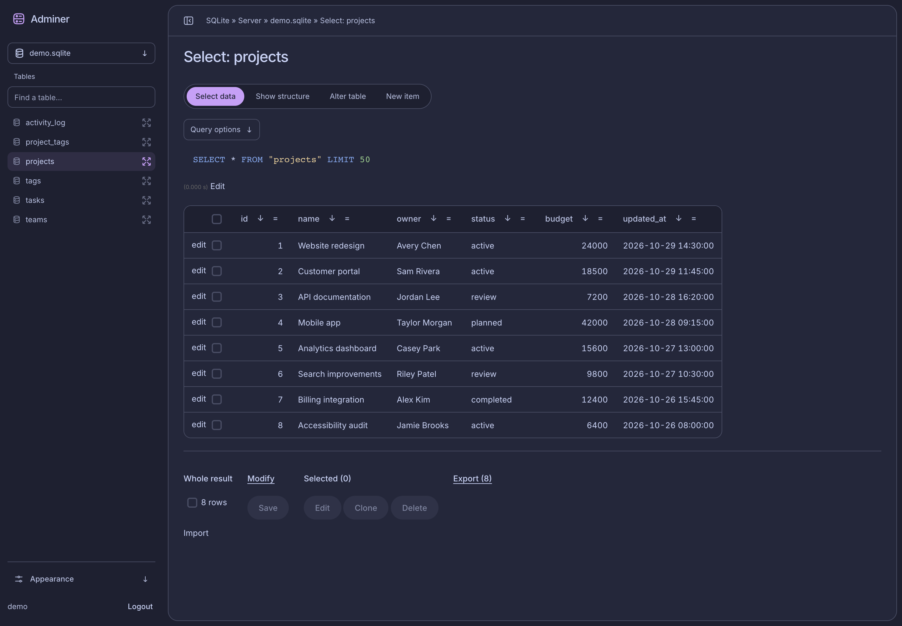
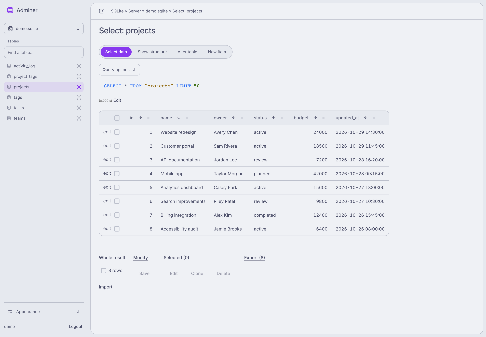

# Adminer

Adminer 6.2.0 with a collapsible sidebar, saved palettes, and Arc controls.




## Open locally

With Laravel Valet or Laravel Herd configured, open [adminer.test](http://adminer.test). Use `adminer.<tld>` if your local domain differs.

Point the site at `public/`. Keep `.env`, `src/`, and `vendor/` outside the web root. Use `/adminer.php` for plain Adminer without custom plugins.

## Quick controls

- **⌘B** or **Ctrl+B**: toggle the sidebar.
- **Escape**: close the mobile sidebar.
- **Find a table**: filter table names.
- **Query options**: filters, columns, sorting, and limits.
- **Appearance**: mode, palettes, and language. Choose **Latte** for a light background.

## Optional credentials

```bash
cp .env.example .env
```

Set `USERNAME` and `PASSWORD` in `.env`. Never commit credentials.

## Development

Built assets are committed. After changing `resources/ui/`:

```bash
npm ci
npm run typecheck
npm run build
```

- Plugins: [`src/plugins.php`](src/plugins.php)
- Styles: [`public/assets/css/`](public/assets/css/)
- Browser scripts: [`public/assets/js/`](public/assets/js/)
- Arc sources and license: [`resources/ui/arc/`](resources/ui/arc/)
- Unmodified Adminer release: [`vendor/adminer/UPSTREAM.md`](vendor/adminer/UPSTREAM.md)
